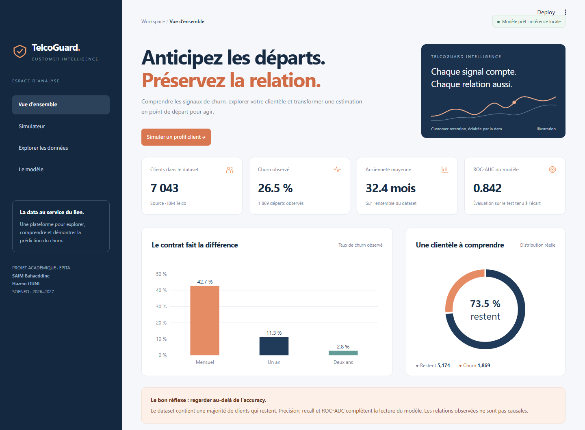
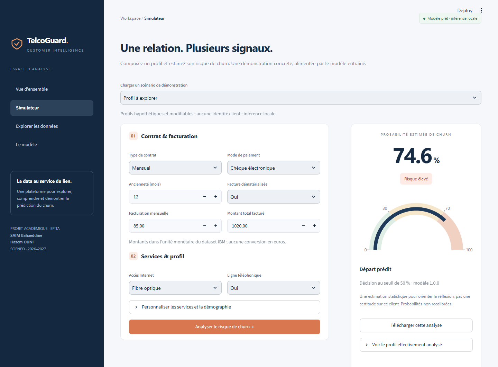

Plateforme Streamlit
====================

La plateforme locale propose quatre vues : Vue d'ensemble, Simulateur,
Explorer les données et Le modèle. L'API FastAPI conserve son contrat et
son authentification ; Streamlit utilise directement la Pipeline locale de confiance.

Démarrage depuis la racine :

.. code-block:: console

   poetry install
   poetry run telcoguard download
   poetry run telcoguard train
   poetry run streamlit run streamlit_app.py --server.port 8501

Dans l'environnement déjà installé sous Windows :

.. code-block:: powershell

   .\.venv\Scripts\python -m streamlit run streamlit_app.py --server.port 8501

Ouvrir http://127.0.0.1:8501. Aucune clé API ni deuxième serveur n'est nécessaire
pour cette démonstration. La configuration lie le service à 127.0.0.1 ; il n'est
pas prévu comme service public authentifié. Arrêt : Ctrl+C dans le terminal serveur.

Déploiement Streamlit Community Cloud
----------------------------------------

Choisir Python 3.11 dans Advanced settings et streamlit_app.py comme point d'entrée.
Le projet accepte Python 3.11/3.12, pas Python 3.14. Pour modifier la version d'une
application déjà déployée, suivre la procédure officielle de suppression du
déploiement puis redéploiement ; le dépôt GitHub reste conservé.

Au premier démarrage sans CSV ni modèle, la plateforme télécharge et valide le CSV
IBM puis entraîne la Pipeline avec la configuration reproductible existante. Elle
affiche un indicateur de préparation. Un verrou protège cette opération entre les
sessions concurrentes du même processus. Les modèles existants sont préservés.
Les fichiers restent exclus de Git et peuvent disparaître avec le disque éphémère
du service ; la préparation sera alors renouvelée. Aucune donnée synthétique ni
modèle sérialisé distant n'est utilisé comme remplacement.

Le serveur doit pouvoir contacter raw.githubusercontent.com et écrire dans data/
et models/. Un échec affiche un message et un bouton de nouvelle tentative, avec
une erreur détaillée dans les logs. TELCOGUARD_AUTO_SETUP=false désactive cette
initialisation. Un chemin personnalisé de modèle manquant reste une erreur de
configuration ; aucun artefact personnalisé n'est remplacé automatiquement.
La clé FastAPI n'est pas lue par le dashboard et l'API garde sa protection.

Parcours de soutenance
----------------------------------------

1. Présenter les effectifs, la distribution du churn et les taux par contrat.
2. Ouvrir Simulateur et analyser le profil hypothétique proposé.
3. Charger Client fidèle, relancer l'analyse et comparer les estimations sans
   interpréter cette comparaison comme l'effet causal d'une intervention.
4. Personnaliser les 19 variables via les contrôles et l'expander.
5. Télécharger l'analyse JSON et consulter le profil effectivement analysé.
6. Explorer une cohorte filtrée par contrat, accès Internet et ancienneté.
7. Présenter Le modèle : comparaison DummyClassifier, matrice de confusion et limites.

Les services incompatibles sont normalisés : sans téléphone implique No phone
service ; sans Internet implique No internet service. Le profil réellement soumis
est visible dans le résultat. Changer de scénario efface la prédiction précédente.
Les montants conservent l'unité monétaire du dataset, sans conversion en euros.

Les statistiques reposent sur data/raw/telco.csv validé, jamais sur DATA.csv ou
des nombres générés. Les identifiants sont exclus. L'aperçu tabulaire présente au
plus 100 lignes ; les graphiques portent sur toute la sélection. Une sélection vide
affiche une aide ; si la préparation est désactivée ou échoue, un modèle absent
empêche l'inférence et propose un réentraînement.
Les ressources sont mises en cache avec invalidation selon leur modification.

Vérification
------------

Les tests AppTest parcourent les quatre vues, calculent une prédiction avec un
modèle temporaire, changent de scénario et vérifient une sélection vide et les
ressources absentes. Ils ne nécessitent ni réseau ni dataset IBM.

.. code-block:: console

   poetry run pytest tests/integration/test_dashboard.py

Une vérification visuelle optionnelle utilise Playwright et Chrome installé :

.. code-block:: console

   poetry run python -m pip install playwright
   poetry run python scripts/preview_dashboard.py

Cette commande attend Streamlit sur le port 8501, parcourt les vues, analyse un
profil et produit les captures ordinateur/mobile et browser-checks.json dans
reports/ui. Playwright est un outil de revue optionnel, pas une dépendance du produit.

